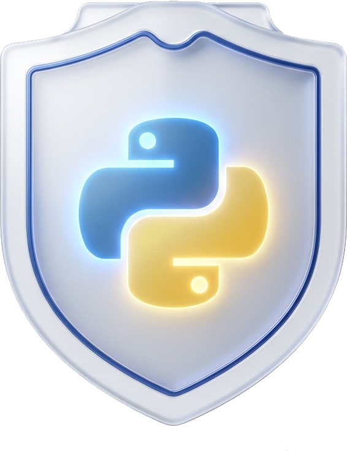
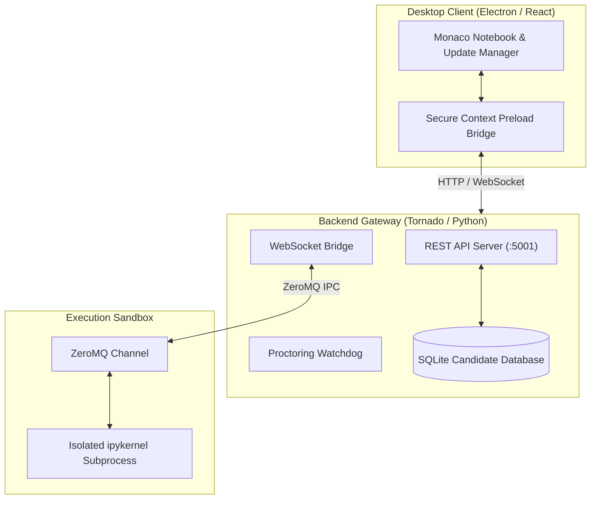

<div align="center">

  

  # PyShield Studio 🛡️
  
  **Next-Generation Offline Proctored Python Notebook & Zero-Trust Security IDE**

  [](https://github.com/yash12345-ctrl/PyShield-Studio/releases)
  [](https://github.com/yash12345-ctrl/PyShield-Studio/releases)
  [](https://github.com/yash12345-ctrl/PyShield-Studio/actions)
  [](LICENSE)

  <p align="center">
    <a href="#-quick-downloads">Downloads</a> •
    <a href="#-key-features">Features</a> •
    <a href="#-architecture">Architecture</a> •
    <a href="#-quick-start">Quick Start</a> •
    <a href="#-ci-cd-automation">CI/CD Pipeline</a> •
    <a href="#-tech-stack">Tech Stack</a>
  </p>

</div>

---

## 📖 Overview

**PyShield Studio** is a secure, high-performance offline Python Notebook IDE designed for examinations, proctored laboratory assessments, and security-critical coding environments. 

It combines the interactive agility of Jupyter Notebooks with military-grade proctoring, isolated subprocess kernel sandboxing, real-time ZeroMQ-to-WebSocket IPC streaming, and automated cross-platform update management.

---

## 📦 Quick Downloads

Pre-built binaries for **Windows** and **Linux** are compiled and published automatically via GitHub Actions CI/CD:

| Operating System | Package Type | Architecture | Description & Quick Install |
| :--- | :--- | :--- | :--- |
| **🐧 Linux** | **`.deb` Package** | `x86_64 / amd64` | `sudo dpkg -i pyshield-studio_1.0.4_amd64.deb` *(Native Ubuntu/Debian integration)* |
| **🐧 Linux** | **`AppImage`** | `x86_64` | `chmod +x PyShield-Studio-1.0.4.AppImage && ./PyShield-Studio-1.0.4.AppImage` |
| **🪟 Windows** | **Setup `.exe`** | `x64` | Full setup wizard (path picker, desktop shortcut, PATH variable) |
| **🪟 Windows** | **Portable `.zip`** | `x64` | Standalone portable executable |

👉 **[Download Latest v1.0.4 Releases Here](https://github.com/yash12345-ctrl/PyShield-Studio/releases/tag/v1.0.4)**

---

## ✨ Key Features

### 🛡️ 1. Proctored Exam & Anti-Tamper Security
* **Offline SQLite Authentication**: Local candidate verification without requiring an external internet connection.
* **Workspace Isolation**: Ephemeral session tokens with strict folder boundary isolation.
* **Session Persistence**: Smart state caching preserves active work across accidental window closures without compromising logout security.
* **Watchdog Monitoring**: Automated proctoring hooks that track background process disruptions.

### ⚡ 2. Supervised ZeroMQ Kernel Subprocesses
* **Zero-Trust Process Isolation**: Python code executes inside standalone `ipykernel` subprocesses assigned to dynamic ephemeral OS ports.
* **Real-Time IPC Streaming**: Low-latency ZeroMQ-to-WebSocket bridge streaming stdout, stderr, execution counts, and rich tracebacks.
* **Variable Inspector**: Live memory tracking inspecting active Python variables, data types, and sizes.

### 💻 3. Modern Monaco Notebook Experience
* **VS Code / JupyterLab Ergonomics**: Full-featured Monaco code editor with syntax highlighting, autocomplete, and markdown cells.
* **Native Notebook Persistence**: Seamless load and export support for standard `.ipynb` files.
* **Built-in Laboratory Datasets**: Offline datasets ready for analysis and algorithmic benchmark tasks.

### 🔄 4. Multi-Platform Update Manager & Cloud Node
* **Live OS Detection**: Automatically highlights Windows vs Linux packages based on the running environment.
* **Segmented Platform Switcher**: Toggle between Linux and Windows tabs to copy installation snippets or download packages.
* **Cloud & Local Synchronization**: Seamless fallback from live Google Cloud distribution nodes to local offline manifests.

---

## 🏗️ Architecture



---

## 🚀 Quick Start (Development)

### 1. Prerequisites
* **Python**: `3.10+`
* **Node.js**: `18+` or `22+` (with `npm`)

### 2. Backend Setup
```bash
# Clone the repository
git clone https://github.com/yash12345-ctrl/PyShield-Studio.git
cd PyShield-Studio

# Create and activate virtual environment
python3 -m venv .venv
source .venv/bin/activate  # On Windows: .venv\Scripts\activate

# Install backend dependencies
pip install -r backend/requirements.txt

# Start ZeroMQ REST & WebSocket Bridge
python backend/run_backend.py
```
*Backend runs on `http://127.0.0.1:5001` (WebSocket: `ws://127.0.0.1:5001/ws`).*

### 3. Frontend & Desktop Setup
```bash
# Enter frontend directory
cd frontend

# Install dependencies
npm install

# Option A: Run Vite Web Development Server
npm run dev

# Option B: Run Live Electron Desktop App
npm run electron:dev
```

---

## 🛠️ Build & Packaging Commands

All packages are organized cleanly into `dist-electron/linux/` and `dist-electron/windows/`:

```bash
# Build Linux Universal AppImage
npm run electron:build:linux

# Build Linux Debian / Ubuntu Package (.deb)
npm run electron:build:deb

# Build Both Linux Packages at once
npm run electron:build:all:linux

# Build Windows Executable & Installer (.exe / .zip)
npm run electron:build:win
```

---

## 🤖 CI/CD Automation Pipeline

PyShield Studio uses **GitHub Actions** for fully automated cross-platform cloud builds.

Whenever a git tag is pushed (e.g., `v1.0.3`):
```bash
git tag v1.0.3
git push origin v1.0.3
```

1. **`windows-latest` Runner**: Compiles the native Windows `.exe` and `.zip` bundle.
2. **`ubuntu-latest` Runner**: Compiles the native Linux `.AppImage` and `.deb` bundle with SUID sandbox permissions.
3. **Automated Release**: Packages are uploaded and published to the [GitHub Releases](https://github.com/yash12345-ctrl/PyShield-Studio/releases) page automatically.

---

## 💻 Tech Stack

* **Frontend**: React 19, TypeScript, Vite, Monaco Editor, Lucide Icons, Vanilla CSS
* **Desktop Runtime**: Electron 44, Node.js
* **Backend**: Python 3.10+, Tornado, ZeroMQ (`pyzmq`), Jupyter `ipykernel`
* **Database**: SQLite 3
* **CI/CD & DevOps**: GitHub Actions, Debian `dpkg-deb`, AppImageKit

---

## 📄 License

This project is licensed under the **MIT License** — see the [LICENSE](LICENSE) file for details.
