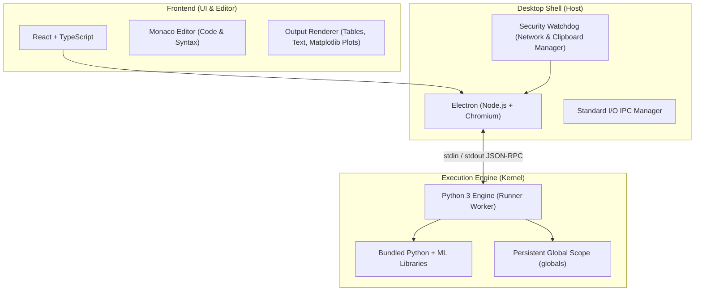

# Technical Requirements Document (TRD)

## Project: Offline Proctored Python Notebook
**Document Version:** 1.0.0  
**Status:** Draft / Approved for Design  
**Target Platform:** Desktop (Windows, macOS, Linux)

---

## 1. Project Overview & Objectives

The goal is to develop a standalone desktop application for Python programming and college-level machine learning model training. The application provides an interactive cell-based execution experience (similar to Jupyter Notebook) while strictly enforcing exam/proctoring constraints:

1. **Strict Offline Enforcement:** If an active internet connection (Wi-Fi, Ethernet, Hotspot) is detected, the application immediately halts and locks the interface.
2. **Clipboard Lockdown:** Copying and pasting (`Ctrl+C`, `Ctrl+V`, context menus, drag-and-drop) are disabled to prevent unauthorized code sharing.
3. **Self-Contained Execution Engine:** Python code and ML training models execute locally without requiring external cloud servers, local network servers, or pre-installed system Python.

---

## 2. Technology Stack & Language Choices



### 2.1 Language & Framework Summary

| Layer | Language | Framework / Tooling | Justification |
|---|---|---|---|
| **Frontend UI** | **TypeScript** | **React** + **Vite** | Modern, type-safe, component-driven UI for managing reactive notebook cells and outputs. |
| **Code Editor** | **TypeScript / JavaScript** | **Monaco Editor** *(Core of VS Code)* | Industry standard for Python syntax highlighting, bracket matching, line numbers, and keyboard event control. |
| **Desktop Shell** | **TypeScript / JavaScript** | **Electron** *(Node.js Runtime)* | Comprehensive control over native desktop windows, global shortcuts, clipboard API, and process piping. |
| **Execution Engine** | **Python 3 (3.10+)** | **Custom Engine (Standard Library)** | Native execution of user Python code, dynamic `exec()` state persistence, and output streaming. |
| **ML Runtime Environment** | **Python** | **Portable Python Environment** (Embedded Python / Conda-Pack) | Fully offline pre-bundled ML libraries (`numpy`, `pandas`, `scikit-learn`, `matplotlib`, `seaborn`, `torch-cpu`). |

---

## 3. Component Architecture & Specifications

### 3.1 Frontend Layer (Notebook UI)
* **Cell Management:** Dynamic addition, deletion, reordering, and execution of code and markdown cells.
* **Output Rendering:**
  * Plain text output (`stdout` / `stderr`).
  * Tabular preview for Pandas DataFrames.
  * Base64 PNG image rendering for Matplotlib / Seaborn visual plots.
  * Real-time execution indicators (running spinner, execution time, error tracebacks).
* **Keyboard & Clipboard Restrictions:**
  * Global and element-level event interception (`keydown`, `paste`, `copy`, `cut`).
  * Prevention of browser context menus (`contextmenu` event disabled).
  * Prevention of external drag-and-drop text transfer.

### 3.2 Desktop Host Layer (Electron / Node.js)
* **Offline Inter-Process Communication (IPC):**
  * Spawns the Python engine as a child process using `child_process.spawn`.
  * Communicates exclusively via standard streams (`stdin` / `stdout`) with newline-delimited JSON.
  * **No local HTTP/WebSocket servers are created**, eliminating local port conflicts and ensuring full compliance with offline requirements.
* **Network Watchdog:**
  * Background timer checks network status every 1000ms.
  * Queries system interfaces using OS routing tables and DNS reachability checks.
  * Triggers an immediate full-screen modal lock when external connectivity is detected.
* **OS-Level Anti-Cheat & Window Management:**
  * Periodic clipboard purging (`clipboard.writeText("")`) while application is active.
  * Optional Kiosk mode / Full-Screen lockdown (disabling window minimization during exams).

### 3.3 Backend Execution Engine (Python Worker)
* **Single Persistent Process:**
  * Runs a continuous REPL listener over `sys.stdin`.
  * Executes incoming code payloads inside a shared `execution_globals` dictionary so state persists across cells.
* **Output Redirection:**
  * Custom `io.StringIO` capture or file descriptor duplication to intercept `sys.stdout` and `sys.stderr`.
  * Real-time streaming of stdout back to Node.js.
* **Plot Interception (Matplotlib Hook):**
  * Automatically binds a custom rendering backend or patches `matplotlib.pyplot.show()` to export current active figures to PNG in-memory, encode to base64, and transmit as image output objects.
* **Execution Interruption:**
  * Platform-specific signal handling (`SIGINT` on POSIX, `GenerateConsoleCtrlEvent` / `CTRL_C_EVENT` on Windows) to interrupt running loops without killing the kernel.

---

## 4. Communication Protocol (JSON-RPC over stdio)

### 4.1 Execute Request (Node.js -> Python Engine)
```json
{
  "jsonrpc": "2.0",
  "id": "req-001",
  "method": "execute_cell",
  "params": {
    "cell_id": "cell-a1b2",
    "code": "import numpy as np\nx = np.array([1, 2, 3])\nprint(x)"
  }
}
```

### 4.2 Output Stream & Result (Python Engine -> Node.js)
```json
{
  "jsonrpc": "2.0",
  "id": "req-001",
  "type": "stream",
  "stream": "stdout",
  "text": "[1 2 3]\n"
}
```

```json
{
  "jsonrpc": "2.0",
  "id": "req-001",
  "type": "result",
  "status": "success",
  "cell_id": "cell-a1b2",
  "execution_time_ms": 42
}
```

### 4.3 Interrupt Request
```json
{
  "jsonrpc": "2.0",
  "id": "req-002",
  "method": "interrupt_execution"
}
```

---

## 5. Security & Proctoring Requirements

| Requirement | Implementation Strategy |
|---|---|
| **Internet Killswitch** | Poll network interfaces via Node.js/OS. If default gateway or DNS is reachable, immediately freeze UI with a lockdown overlay. |
| **No Copy / Paste** | Intercept `copy`, `paste`, `cut`, `dragstart`, `drop` events on DOM and Monaco editor. Clear OS clipboard on app focus. |
| **Inspect / DevTools Disabled** | Disable DevTools shortcuts (`Ctrl+Shift+I`, `F12`) and block the remote debugging port. |
| **Local File Safety** | Prevent external file imports outside of the workspace directory. |

---

## 6. Pre-bundled Machine Learning Libraries

The application installer will include an embedded Python environment with the following pre-compiled packages:
* **Core:** `python 3.10+`, `pip` (disabled in UI), `wheel`
* **Data & Numerical:** `numpy`, `pandas`, `scipy`
* **Machine Learning:** `scikit-learn`
* **Visualization:** `matplotlib`, `seaborn`
* **Deep Learning (Optional/College Level):** `torch` (CPU-only distribution)

---

## 7. Implementation Roadmap

1. **Phase 1: Custom Python Execution Engine**
   - Implement `kernel.py` (persistent global dictionary, output capture, base64 plot capture, stdio JSON protocol).
2. **Phase 2: Electron Host & Security Layer**
   - Electron initialization with child process spawning.
   - Network connectivity watchdog & UI freeze trigger.
   - Clipboard blocking and keyboard shortcut lockdown.
3. **Phase 3: Frontend Notebook Interface**
   - React + Monaco Editor setup.
   - Cell creation, execution triggers, and output rendering (stdout, tables, plots).
4. **Phase 4: Packaging & Offline Distribution**
   - Bundling portable Python with ML dependencies.
   - Packaging application into a standalone installer (`.exe` / `.dmg` / `.AppImage`).
